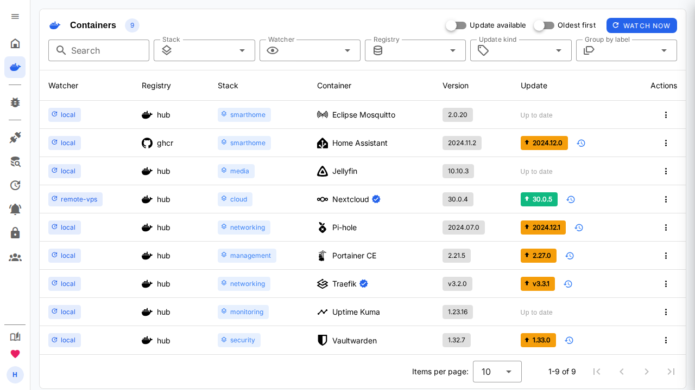
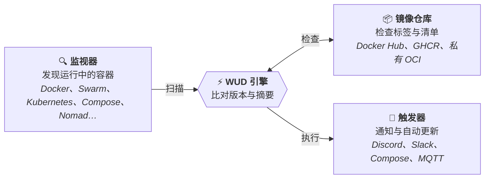

<div align="center">


# What's Up Docker? (WUD)

### *自动、省心地让容器在任意编排平台上保持最新。*

**简体中文** · [English](./README.md)

[](https://hub.docker.com/r/getwud/wud)
[](https://github.com/getwud/wud/stargazers)
[](https://github.com/getwud/wud/actions/workflows/ci.yml)
[](https://github.com/getwud/wud/blob/main/LICENSE)
[](https://getwud.app/)
[](https://github.com/sponsors/fmartinou)
[](https://www.buymeacoffee.com/61rUNMm)
[](https://www.paypal.com/donate/?business=ZSDMEC3ZE8DQ8&no_recurring=0&currency_code=EUR)

<p align="center">
  
  
  
  
  
</p>

<p align="center">
  <a href="https://getwud.app/"><b>📖 文档</b></a> •
  <a href="https://getwud.app/docs/quickstart/"><b>🚀 快速开始</b></a> •
  <a href="https://getwud.app/docs/configuration/"><b>⚙️ 配置</b></a> •
  <a href="https://getwud.app/docs/configuration/triggers/"><b>🔔 触发器</b></a> •
  <a href="https://getwud.app/docs/configuration/registries/"><b>📦 镜像仓库</b></a> •
  <a href="CONTRIBUTING.md"><b>🛠️ 参与贡献</b></a> •
  <a href="https://github.com/getwud/wud/issues"><b>💬 问题与支持</b></a>
</p>

---

</div>

<p align="center">
  
</p>

> [!IMPORTANT]
> **本仓库是 [getwud/wud](https://github.com/getwud/wud) 的派生（fork）版本**，在上游基础上增加了 **Web 界面中文本地化（i18n）**。<br/>
> 与上游的差异、镜像地址及 CI 行为说明请见 [本 Fork 的改动说明](#-本-fork-的改动说明)。

## 💡 关于 WUD

**WUD（What's Up Docker?）** 是一款轻量、主动的容器更新监控与自动化工具。它会持续扫描你的容器环境，在公有与私有镜像仓库中检测镜像更新，进行语义化版本分析，然后通过你常用的通知渠道提醒你 —— 或者无缝触发容器的自动更新。



---

## ✨ 功能特性

- 🔍 **多编排平台引擎**
  监控独立的 Docker 守护进程、基于 TLS 的远程 Docker 引擎、Docker Compose 环境、**Docker Swarm 集群**、原生 **Kubernetes 集群**（Deployment、StatefulSet、DaemonSet、CronJob），以及 **HashiCorp Nomad** 集群。
- 📦 **多镜像仓库集成**
  零配置或带认证地支持 **Docker Hub**、**GitHub Container Registry (GHCR)**、**AWS ECR**、**Google GCR/GAR**、**Azure ACR**、**Quay**、**GitLab**、**Gitea**、**Forgejo**、**Codeberg**、**LinuxServer (LSCR)** 以及任意自定义 / 自建 OCI 镜像仓库。
- 🔔 **30+ 通知与自动化触发器**
  Discord、Matrix、Mattermost、Zulip、XMPP、Telegram、Slack、Signal、WhatsApp、Bark、Prowl、Home Assistant、Gotify、Ntfy、Pushover、Apprise、Webhook、Kafka、AMQP/RabbitMQ、NATS、Opsgenie、PagerDuty、Uptime Kuma、GitHub Actions、GitLab CI、SMTP 邮件、Shell 脚本，以及原生 Docker / Compose / Nomad 自动更新器。
- 🔄 **容器自动更新**
  按需自动拉取新镜像并重建容器（Docker、Docker Compose、Nomad）。
- ⚡ **镜像仓库 Webhook**：[镜像推送通知](website/docs/configuration/registries/webhooks.md)（含 GitLab 自建版）会立即检查匹配的受监控镜像，同时保留已有的标签与触发策略。
- 🔎 **集中式摘要配置**：通过 `CONTAINERDIGESTS` 按名称[为指定 Docker 容器启用摘要监控](website/docs/configuration/watchers/README.md#central-digest-configuration)，并保持容器标签的优先级。
- 🏷️ **SemVer 与标签过滤**
  灵活的版本策略：以 `semver`（主版本、次版本、补丁）为目标，支持自定义正则表达式、固定版本，或定义标签的包含 / 排除规则。
- 🖥️ **交互式 Web 界面与 REST API**
  清爽、响应式的 Web 面板，可查看容器状态、手动触发更新检查，并通过功能完整的 REST API 查询数据。
- 🌐 **多语言 Web 界面（本 Fork 新增）**
  界面已完整本地化，支持 **简体中文（默认）** 与 **英文**，可在个人资料页即时切换，并按用户账号记忆。
- 📊 **适配 Prometheus 与 Grafana**
  内置 Prometheus `/metrics` 端点，并提供预置的 Grafana 面板用于可观测性。
- 🔒 **企业级认证与 RBAC**
  基于角色的访问控制（`admin`、`rw`、`ro`）、数据库支持的用户管理、个人 API Token，以及基于 **OpenID Connect (OIDC)**（Keycloak、Authentik、Authelia 等）或本地账号的单点登录。

---

## 🤝 本 Fork 的改动说明

本仓库为 [`getwud/wud`](https://github.com/getwud/wud) 的派生版本，在上游 `main` 基础上增加了 **Web 界面国际化（i18n）**，主要改动如下。

### 1. Web 界面全量中文本地化

- 引入 [`vue-i18n`](https://vue-i18n.intlify.dev/) v11（Composition API 模式），覆盖全部 12 个视图与 21 个组件（以及 `App.vue`）的用户可见文案。
- 新增语言包目录 [`ui/src/i18n/`](ui/src/i18n/)：`locales/en.ts` 作为唯一的 key 来源（schema 基准），`locales/zh-CN.ts` 提供简体中文翻译。
- 通过 TypeScript 的 `MessageSchema` 与自动化测试双重保证两种语言的 key **完全一致**、占位符一致，且不允许出现空翻译。
- Vuetify 内置组件文案（表格分页、空状态、日期选择器等）通过 vue-i18n 适配器一并本地化。
- 日期与数字格式随当前语言变化（中文 `2025/01/15`，英文 `01/15/2025`）。

### 2. 默认语言与语言切换

- **默认语言为简体中文**。语言解析优先级依次为：
  1. 用户个人资料中的偏好（`preferences.locale`）
  2. 本浏览器上次选择的语言（`localStorage`）
  3. 浏览器语言（`zh*` → 简体中文，`en*` → 英文）
  4. 最终默认值 **简体中文**
- 提供两处切换入口：**我的资料 → 外观 → 界面语言**，以及 **侧边栏底部用户菜单 → 语言**。
- 切换即时生效（无需刷新），并保存到用户资料，跨浏览器保持一致；保存失败时自动回滚。

### 3. 术语处理

技术名词与产品名保持英文，不做翻译，例如：`Docker`、`WUD`、`OIDC`、`semver`、`SSE`、`API`、`Digest`、`Stack`，以及后端返回的 registry / watcher / trigger 名称。

### 4. CI 与镜像发布行为

- **镜像发布**：推送至 `main` 会自动构建并发布多架构（`linux/amd64`、`linux/arm64`）镜像到 GHCR：

  ```bash
  docker pull ghcr.io/15515151/wud:main
  ```

- **不再依赖 Docker Hub 凭据**：`publish` 作业会先检测 `DOCKER_USERNAME` / `DOCKER_PASSWORD`。未配置时仅推送到 GHCR，而不是让整个流水线失败。
- **`e2e-test` 不再阻塞发布**：该作业需要上游私有的 registry 凭据（AWS ECR、TrueForge、GitLab）才能通过，在任何 fork 上都无法变绿。它仍会照常运行并报告结果，但 `publish` 只依赖无需密钥的测试套件。
- **文档部署限定在上游仓库**：`deploy-docs` 会发布到官方域名 `getwud.app`，因此已限定仅在 `getwud/wud` 中运行，fork 上会自动跳过。

### 5. 未改动的部分

后端（`app/`）源码、API 契约、环境变量与 Docker 标签均与上游保持一致，因此本 fork 与上游在部署方式上可以互换。后端返回的错误消息仍为英文，界面上原样展示。

> 如果你的目的是向 [上游项目](https://github.com/getwud/wud) 提交 PR，请以英文 README（[`README.md`](./README.md)）为准。

---

## ⚡ 快速开始

### 1. 使用 Docker 运行

```bash
docker run -d \
  --name wud \
  -p 3000:3000 \
  -e WUD_AUTH_ADMIN_USER="admin" \
  -e WUD_AUTH_ADMIN_PASSWORD="MySecurePassword123" \
  -v /var/run/docker.sock:/var/run/docker.sock \
  getwud/wud:latest
```

> 💡 想使用本 fork 的中文界面，请将镜像改为 `ghcr.io/15515151/wud:main`。

### 2. 使用 Docker Compose 运行

```yaml
services:
  whatsupdocker:
    image: getwud/wud:latest
    container_name: wud
    ports:
      - "3000:3000"
    environment:
      - WUD_AUTH_ADMIN_USER=admin
      - WUD_AUTH_ADMIN_PASSWORD=MySecurePassword123
    volumes:
      - /var/run/docker.sock:/var/run/docker.sock
    restart: unless-stopped
```

> 🌐 **访问 Web 界面**：在浏览器中打开 [`http://localhost:3000`](http://localhost:3000)（使用 `admin` / `MySecurePassword123` 登录）。界面默认显示简体中文，可在 **我的资料 → 外观 → 界面语言** 中切换为英文。

### 3. 单次 CLI 模式运行（CI/CD 与 Cron）

WUD 也可以作为无状态的无头 CLI 工具运行，不启动 Web 服务，也不创建数据库文件：

```bash
# 执行一次扫描，并以 JSON 输出容器状态
docker run --rm \
  -v /var/run/docker.sock:/var/run/docker.sock \
  -e WUD_RUN_MODE=oneshot \
  getwud/wud:latest watch

# 用于 CI/CD 门禁：只要有可用更新就以退出码 1 结束
docker run --rm \
  -v /var/run/docker.sock:/var/run/docker.sock \
  -e WUD_RUN_MODE=oneshot \
  getwud/wud:latest watch --update-available --fail-on-update
```

📖 完整的参数、NDJSON 输出与 cron 示例请参阅 [单次无头模式文档](https://getwud.app/docs/configuration/oneshot/)。

---

## 🧩 支持的集成

### 🔍 监视器与编排平台

| 环境 | 支持的工作负载 | 配置方式 |
| :--- | :--- | :---: |
| [**Docker**](https://getwud.app/docs/configuration/watchers/) | 本地 socket、基于 TLS 的远程 TCP、Docker Compose | 内置（默认启用） |
| [**Docker Swarm**](https://getwud.app/docs/configuration/watchers/swarm/) | Service、Stack、副本与全局工作负载 | Socket / 远程 TCP over TLS |
| [**Kubernetes**](https://getwud.app/docs/configuration/watchers/kubernetes/) | Deployment、StatefulSet、DaemonSet、CronJob | 集群内 RBAC / Kubeconfig |
| [**Nomad**](https://getwud.app/docs/configuration/watchers/nomad/) | Job（`service`、`batch`、`system`）、Task Group | HTTP API / ACL Token |

### 📦 镜像仓库

| 镜像仓库 | 说明 | 认证方式 |
| :--- | :--- | :---: |
| [**Docker Hub**](https://getwud.app/docs/configuration/registries/hub/) | 公有与私有 Docker Hub 镜像 | 匿名 / Token / 密码 |
| [**Docker Hardened Images (DHI)**](https://getwud.app/docs/configuration/registries/dhi/) | Docker 加固镜像（`dhi.io`） | Token / 密码 |
| [**GitHub (GHCR)**](https://getwud.app/docs/configuration/registries/ghcr/) | GitHub Container Registry 包 | 个人访问令牌（PAT） |
| [**AWS ECR**](https://getwud.app/docs/configuration/registries/ecr/) | Amazon Elastic Container Registry | AWS IAM 密钥 / IAM 角色 |
| [**Google GCR / Artifact Registry**](https://getwud.app/docs/configuration/registries/gcr/) | GCP 容器与制品仓库 | 服务账号密钥（JSON） |
| [**Azure ACR**](https://getwud.app/docs/configuration/registries/acr/) | Azure 容器仓库 | 服务主体 / 管理员密钥 |
| [**GitLab Registry**](https://getwud.app/docs/configuration/registries/gitlab/) | GitLab 容器仓库 | Deploy Token / PAT |
| [**Quay.io**](https://getwud.app/docs/configuration/registries/quay/) | Red Hat Quay | 机器人账号 / OAuth Token |
| [**自建 / OCI**](https://getwud.app/docs/configuration/registries/custom/) | Harbor、Nexus、Artifactory、Gitea、Forgejo、Codeberg | Basic Auth / Bearer Token |

### 🔔 触发器与通知

| 类别 | 支持渠道 |
| :--- | :--- |
| **聊天与消息** | [Discord](https://getwud.app/docs/configuration/triggers/discord/)、[Matrix](https://getwud.app/docs/configuration/triggers/matrix/)、[Mattermost](https://getwud.app/docs/configuration/triggers/mattermost/)、[Signal](https://getwud.app/docs/configuration/triggers/signal/)、[Telegram](https://getwud.app/docs/configuration/triggers/telegram/)、[Slack](https://getwud.app/docs/configuration/triggers/slack/)、[Rocket.Chat](https://getwud.app/docs/configuration/triggers/rocketchat/)、[WhatsApp](https://getwud.app/docs/configuration/triggers/whatsapp/)、[Zulip](https://getwud.app/docs/configuration/triggers/zulip/)、[XMPP](https://getwud.app/docs/configuration/triggers/xmpp/) |
| **推送通知与告警** | [Bark](https://getwud.app/docs/configuration/triggers/bark/)、[Gotify](https://getwud.app/docs/configuration/triggers/gotify/)、[IFTTT](https://getwud.app/docs/configuration/triggers/ifttt/)、[Ntfy](https://getwud.app/docs/configuration/triggers/ntfy/)、[Opsgenie](https://getwud.app/docs/configuration/triggers/opsgenie/)、[PagerDuty](https://getwud.app/docs/configuration/triggers/pagerduty/)、[Prowl](https://getwud.app/docs/configuration/triggers/prowl/)、[Pushover](https://getwud.app/docs/configuration/triggers/pushover/)、[Apprise](https://getwud.app/docs/configuration/triggers/apprise/) |
| **自动更新与编排** | [Docker 容器](https://getwud.app/docs/configuration/triggers/docker/)、[Docker Compose](https://getwud.app/docs/configuration/triggers/docker-compose/)、[HashiCorp Nomad](https://getwud.app/docs/configuration/triggers/nomad/) |
| **IoT 与消息队列** | [AMQP (RabbitMQ)](https://getwud.app/docs/configuration/triggers/amqp/)、[Apache Kafka](https://getwud.app/docs/configuration/triggers/kafka/)、[MQTT（Home Assistant 自动发现）](https://getwud.app/docs/configuration/triggers/mqtt/)、[NATS](https://getwud.app/docs/configuration/triggers/nats/) |
| **自动化与自定义** | [GitHub Actions](https://getwud.app/docs/configuration/triggers/githubactions/)、[GitLab CI](https://getwud.app/docs/configuration/triggers/gitlabci/)、[Home Assistant（Webhook）](https://getwud.app/docs/configuration/triggers/homeassistant/)、[HTTP Webhook](https://getwud.app/docs/configuration/triggers/http/)、[Shell 命令执行](https://getwud.app/docs/configuration/triggers/command/)、[SMTP 邮件](https://getwud.app/docs/configuration/triggers/smtp/)、[Uptime Kuma](https://getwud.app/docs/configuration/triggers/uptimekuma/) |

---

## 🏷️ 通过标签与注解进行配置

WUD 既可以通过环境变量进行全局配置，也可以用 Docker 标签或 Kubernetes 注解，针对单个容器 / 工作负载进行细粒度配置：

### Docker 与 Compose（标签）

```yaml
services:
  my-app:
    image: myorg/myapp:1.2.0
    labels:
      # 只考虑 semver 的次版本与补丁更新（例如 1.2.1、1.3.0，但不含 2.0.0）
      - "wud.tag.include=^1\\.\\d+\\.\\d+$"
      - "wud.tag.transform=^v(.*)$$ => $$1"

      # 将更新通知发送到指定的 Discord Webhook
      - "wud.trigger.discord.mywebhook.enabled=true"

      # 有可用更新时自动重建该容器
      - "wud.trigger.docker.myupdater.enabled=true"
```

### Kubernetes（注解）

```yaml
apiVersion: apps/v1
kind: Deployment
metadata:
  name: my-app
  namespace: default
  annotations:
    # 显式监控该工作负载
    getwud.app/watch: "true"

    # 只考虑 semver 的次版本与补丁更新
    getwud.app/tag.include: "^1\\.\\d+\\.\\d+$"
    getwud.app/tag.transform: "^v(.*)$ => $1"

    # WUD 界面中的自定义显示图标
    getwud.app/display.icon: "mdi:kubernetes"
```

全部配置项请参阅 [配置中心](https://getwud.app/docs/configuration/)。

---

## 📚 文档

完整的环境搭建指南、进阶配置、教程与 API 参考，请查看官方文档：

👉 **[https://getwud.app/](https://getwud.app/)**

- 🚀 [快速上手与教程](https://getwud.app/docs/quickstart/)
- ⚙️ [配置参考](https://getwud.app/docs/configuration/)
- 🔍 [Docker 监视器与 TLS](https://getwud.app/docs/configuration/watchers/)
- 📦 [镜像仓库认证](https://getwud.app/docs/configuration/registries/)
- 🔔 [触发器与自动化配置](https://getwud.app/docs/configuration/triggers/)
- 📊 [Prometheus 与 Grafana 监控](https://getwud.app/docs/monitoring/)
- 🔌 [REST API 参考](https://getwud.app/docs/api/)
- ❓ [常见问题（FAQ）](https://getwud.app/docs/faq/)

> 官方文档站点为英文。本项目源码内的 `website/docs/` 同样保持英文原始内容。

---

## 💖 支持 WUD

WUD 是一款免费开源软件，由作者满怀热情地开发与维护。如果 WUD 为你节省了时间，或帮助你的家庭实验室与生产环境容器保持最新，欢迎支持它的持续开发：

- 💖 **[在 GitHub Sponsors 上赞助 @fmartinou](https://github.com/sponsors/fmartinou)**
- ☕ **[请作者喝杯咖啡](https://www.buymeacoffee.com/61rUNMm)**
- 💳 **[通过 PayPal 捐赠](https://www.paypal.com/donate/?business=ZSDMEC3ZE8DQ8&no_recurring=0&currency_code=EUR)**

你的支持将用于域名续费（`getwud.app`）、AI 开发工具订阅，以及回报作者在维护镜像仓库集成与开发新功能上投入的时间。谢谢！

---

## 📄 许可证

本项目为开源软件，基于 [MIT 许可证](https://github.com/getwud/wud/blob/main/LICENSE) 发布。
